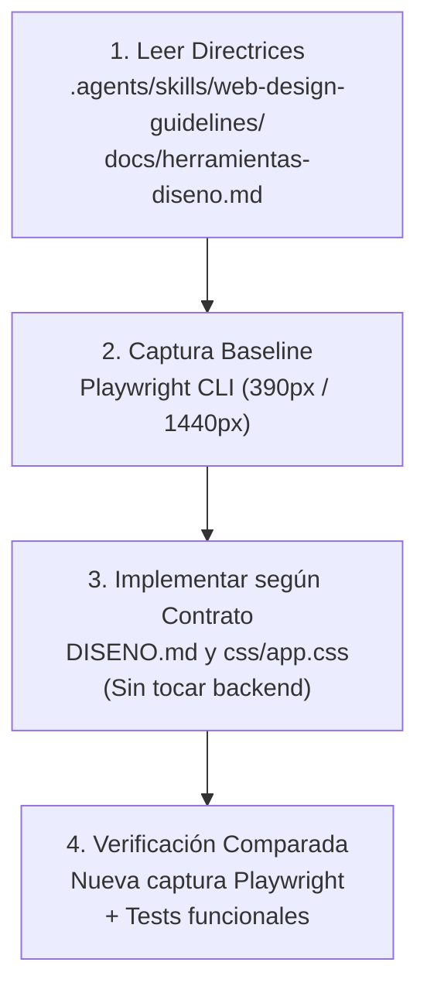

# Herramientas y Referencias de Diseño: MeteoSurf_Cs

Este documento consolida y estandariza las herramientas, directrices y referencias de diseño para el desarrollo de la interfaz de usuario de **MeteoSurf_Cs**. Proporciona un marco reutilizable, verificable y con coste cero para futuros agentes de IA (implementadores, auditores, probadores e investigadores) y desarrolladores.

---

## 1. Principios Rectores del Proyecto

1. **Utilidad y legibilidad costera:** MeteoSurf_Cs es una PWA técnica de previsión y datos marinos (oleaje, viento, mareas, boyas en tiempo real), no una landing page de marketing. Debe ser perfectamente legible bajo luz solar directa en la playa o espigón.
2. **Coste cero absoluto:** Prohibido el gasto de cuotas de pago o APIs de generación sintética de imágenes. El flujo de trabajo visual se apoya en capturas reales con Playwright CLI, contratos de diseño explícitos y recursos fotográficos libres existentes (Wikimedia Commons).
3. **Accesibilidad e integridad técnica (WCAG 2.1 AA):** Ratios de contraste perceptualmente validados (mínimo 4.5:1 en texto normal, 3:1 en interactivos), estados `:focus-visible` nativos, tamaños táctiles de 44x44px y compatibilidad total con navegación por teclado.
4. **Preservación del motor físico:** Las fórmulas, endpoints y algoritmos de `backend/motor_fisica.py` y `scripts/realtime.py` son intocables; la capa visual consume y presenta los datos sin alterar su semántica.

---

## 2. Web Design Guidelines (Integración Local como Skill)

La skill oficial de Web Design Guidelines de Vercel Labs está integrada directamente en el repositorio dentro de `.agents/skills/web-design-guidelines/`.

### 2.1 Origen, Proveniencia y Licencia

- **Repositorio de la skill upstream:** [`https://github.com/vercel-labs/agent-skills`](https://github.com/vercel-labs/agent-skills)
  - **Ruta upstream:** `skills/web-design-guidelines/SKILL.md`
  - **Commit SHA verificado:** `063bee94c3f4df8453406c830b0a7df0f2860278`
- **Repositorio de especificaciones upstream:** [`https://github.com/vercel-labs/web-interface-guidelines`](https://github.com/vercel-labs/web-interface-guidelines)
  - **Archivo de reglas upstream:** [`command.md`](https://raw.githubusercontent.com/vercel-labs/web-interface-guidelines/main/command.md) y [`AGENTS.md`](https://raw.githubusercontent.com/vercel-labs/web-interface-guidelines/main/AGENTS.md)
  - **Commit SHA verificado:** `434b7f91364665f2f733b310ec54809bf8f37937`
  - **Licencia:** MIT License (Copyright (c) 2025 Vercel Labs) - Ver copia local en `.agents/skills/web-design-guidelines/LICENSE`.

### 2.2 Archivos Integrados en el Repositorio

- `.agents/skills/web-design-guidelines/SKILL.md`: Definición formal de la skill compatible con Codex/Orca y agentes de IA.
- `.agents/skills/web-design-guidelines/guidelines.md`: Compendio completo de reglas de interfaz y accesibilidad para consulta local u offline.
- `.agents/skills/web-design-guidelines/LICENSE`: Atribución y texto completo de la licencia MIT upstream.

### 2.3 Uso por los Agentes

Los agentes que realicen revisiones de frontend o auditorías de UI deben verificar su código contra estas reglas:

- **Comando conceptual:** `review UI code against web-design-guidelines`
- **Reglas clave aplicadas a MeteoSurf:**
  - Botones con solo icono requieren atributo `aria-label` descriptivo.
  - No usar `outline: none` sin proveer reemplazo visible en `:focus-visible`.
  - Formularios y selectores con etiquetas asociadas explícitamente (`<label for="...">`).
  - Animaciones y transiciones supeditadas a `prefers-reduced-motion`.
  - Formato numérico consistente con `tabular-nums` en mediciones de oleaje y boyas.

---

## 3. Awesome Design (Índices y Referencias Verificadas)

> **Aclaración importante:** Los repositorios de Awesome Design son **índices de recursos y catálogos de referencia en formato Markdown**, NO paquetes de software instalados, ejecutables ni dependencias de npm/pip.

### 3.1 Fuentes Primarias Verificadas (GET 200 y Git Commit SHA)

1. **Awesome Design (Oscar Otero)**
   - **URL:** [`https://github.com/oscarotero/awesome-design`](https://github.com/oscarotero/awesome-design)
   - **Archivo verificado:** [`README.md`](https://raw.githubusercontent.com/oscarotero/awesome-design/master/README.md)
   - **Commit SHA:** `299bd1bd5635d825fab01575336e721e00298fe6`
   - **Naturaleza:** Catálogo curado de guías de diseño, estudios de UX, tipografía, paletas de color y sistemas de iconos de código abierto.

2. **Awesome Design MD (VoltAgent)**
   - **URL:** [`https://github.com/VoltAgent/awesome-design-md`](https://github.com/VoltAgent/awesome-design-md)
   - **Archivo verificado:** [`README.md`](https://raw.githubusercontent.com/VoltAgent/awesome-design-md/main/README.md)
   - **Commit SHA:** `3b605329240ce735b510037cca322f1831fdd7f8`
   - **Licencia:** MIT License
   - **Naturaleza:** Colección estructurada de especificaciones `DESIGN.md` para agentes de IA basada en el formato Stitch DESIGN.md de Google.

### 3.2 Referencias Seleccionadas y Aplicadas a MeteoSurf

A partir del análisis de estas fuentes verificadas, se seleccionan los siguientes patrones prácticos para MeteoSurf:

#### A. Tipografía
- **Pila tipográfica sans-serif técnica:** Uso de tipografías modernas de alta legibilidad para interfaces utilitarias:
  - Primaria recomendada: [`Geist Sans`](https://vercel.com/font/sans) o [`Inter`](https://rsms.me/inter/) con fallback nativo a `-apple-system, BlinkMacSystemFont, "Segoe UI", Roboto, sans-serif`.
  - Pila monoespaciada para datos técnicos: [`Geist Mono`](https://vercel.com/font/sans) o [`JetBrains Mono`](https://www.jetbrains.com/lp/mono/) para boyas, periodos y coordenadas.
- **Alineación numérica marina:** Declaración obligatoria de `font-variant-numeric: tabular-nums` en alturas de ola, periodos y ráfagas para evitar saltos visuales al actualizar datos en tiempo real.
- **Disciplina tipográfica:** Prohibido el uso de tipografías serif como valor por defecto en una herramienta de surf; evitar em-dashes (`—`) en textos visibles de la interfaz.

#### B. Espaciado y Arquitectura de Componentes
- **Escala de espaciado tokenizado:** Múltiplos regulares basados en 4px y 8px:
  - Micro-espaciado: `0.25rem` (4px), `0.5rem` (8px), `0.75rem` (12px)
  - Componentes y contenedores: `1rem` (16px), `1.5rem` (24px), `2rem` (32px)
- **Áreas táctiles mínimas (Touch Targets):** Mínimo estricto de `44x44px` en botones, selector de spots, chips de filtro y botones de la barra inferior en dispositivos móviles conforme a directrices de accesibilidad.
- **Estructura limpia ("Anti-Nested-Box"):** Evitar contenedores dentro de contenedores; usar líneas sutiles de división (`1px solid var(--line)`) y espacios negativos en lugar de marcos anidados redundantes.

#### C. Color, Contraste y Tokens Náuticos
- **Validación de contraste perceptual:** Contraste mínimo de 4.5:1 para texto normal frente al fondo (`--bg` / `--surface`), y ratio superior a 3:1 para bordes interactivos.
- **Paleta costera azul tinta y arena:**
  - *Modo Claro:* Fondo arena/grisáceo suave (`#f7f8f9`), superficie de tarjetas blanca limpia (`#ffffff`), texto azul tinta de alto contraste (`#0d1b2a`), línea divisoria sutil náutica (`#d5dce2`), acento marino (`#1d7090`).
  - *Modo Oscuro:* Mar nocturno profundo (`#0a1118`), superficie oscura marina (`#0f1922`), texto claro de alto contraste (`#e6edf3`), acento marino luminoso (`#38a3c8`).
  - *Anti-Cliché:* Prohibido recurrir a gradientes púrpuras/violetas sintéticos o brillos de neón genéricos de IA.
- **Semáforo funcional de surf:** Respeto íntegro a los 8 niveles funcionales de olas (`--r-flat` a `--r-epic`), calibrando la saturación para armonizar con la paleta sin perder su valor informativo crítico.

---

## 4. Herramientas del Entorno Host y Portabilidad

En la máquina local de Jordi existen herramientas de diseño preconfiguradas globalmente. A continuación se documenta su ubicación, uso y equivalencias portables para otros entornos.

### 4.1 Taste Skill (Anti-Slop Frontend Skill)

- **Ubicación en el host de Jordi:** `C:/Users/Jordi/.agents/skills/taste-skill/SKILL.md` (y ruta de usuario `~/.agents/skills/taste-skill/SKILL.md`).
- **Rol en el proyecto:** Proporciona heurísticas de diseño para evitar interfaces genéricas de IA ("anti-slop"), estableciendo directivas de consistencia, densidad y tipografía.
- **Calibración de Dials fijada para MeteoSurf:**
  - `DESIGN_VARIANCE: 5` (Orden técnico, layout limpio y predecible).
  - `MOTION_INTENSITY: 3` (Microtransiciones funcionales y sobrias, respetando `prefers-reduced-motion`).
  - `VISUAL_DENSITY: 7` (Cockpit de datos náuticos densos: boyas, tablas horarias, ráfagas y ratings).
- **Reglas operativas fijadas:**
  - Cero em-dashes (`—`) en textos de la UI; redacción en español natural y técnico.
  - Bloqueo de consistencia de tema: Una vista no puede alternar bloques oscuros y claros aleatoriamente.
  - Supresión de barras flotantes redundantes en escritorio (ancho >= 800px) para maximizar la superficie de lectura vertical.
- **Instrucción portable (fuera del host):** En entornos sin acceso a la ruta de usuario, los agentes deben seguir directamente las directivas y dials descritos en este documento y en `DISENO.md`.

### 4.2 Image-to-Code Skill y Regla de Coste Cero

- **Ubicación en el host de Jordi:** `C:/Users/Jordi/.agents/skills/image-to-code-skill/SKILL.md`.
- **Rol en el proyecto:** Metodología de análisis visual estructurado de componentes y secciones.
- **REGLA DE COSTE CERO DE JORDI (Prevalencia absoluta):**
  > **Prohibido generar imágenes sintéticas mediante modelos de pago o servicios de difusión.**
  >
  > Todo el presupuesto y cuota de modelos de pago (Claude, Codex) está reservado para Jordi. Los agentes no deben invocar endpoints de generación de pago ni gastar tokens en imágenes.
- **Flujo de Trabajo de Coste Cero Sustitutorio:**
  1. **Captura Previa (Baseline):** Tomar capturas de pantalla reales de la interfaz actual con Playwright CLI en móvil (390x844) y escritorio (1440x1000).
  2. **Contrato de Dirección Visual:** Definir en `DISENO.md` los tokens de color, componentes, jerarquías y reglas de layout.
  3. **Implementación de Código:** Realizar los cambios en `css/app.css` y archivos de vista.
  4. **Captura Comparada de Verificación:** Tomar nuevas capturas con Playwright CLI para validar empíricamente que la implementación cumple el contrato visual y no introduce regresiones de layout ni desbordamientos horizontales.
  5. **Fotografías de spots reales:** Utilizar exclusivamente fotografías libres existentes con atribución y licencia Wikimedia Commons (13 spots de Castellón).
- **Instrucción portable (fuera del host):** El flujo contrato visual + Playwright CLI es 100% portable y no requiere credenciales ni servicios en la nube.

### 4.3 Playwright CLI

- **Ubicación en el host de Jordi:**
  - Script global de acceso: `C:\Users\Jordi\AppData\Roaming\npm\playwright-cli.ps1`
  - Ejecutable estándar: `npx playwright` (Versión instalada: v1.63.0 con Microsoft Edge / Chromium).
- **Comandos de Acceso y Uso Real:**
  - **Verificación de versión:**
    ```bash
    npx playwright --version
    ```
  - **Captura de pantalla en móvil (390x844 - iPhone 12/13/14 estándar):**
    ```bash
    npx playwright screenshot --viewport-size="390,844" --wait-for-timeout=1500 http://localhost:8000 ruta/salida-movil.png
    ```
  - **Captura de pantalla en escritorio (1440x1000):**
    ```bash
    npx playwright screenshot --viewport-size="1440,1000" --wait-for-timeout=1500 http://localhost:8000 ruta/salida-escritorio.png
    ```
  - **Servidor local para capturas:**
    ```bash
    python -m http.server 8000
    ```
- **Instrucción portable (fuera del host):** Funciona en cualquier sistema operativo que disponga de Node.js mediante `npx playwright screenshot <opciones>`.

---

## 5. Guía de Ejecución para Futuros Agentes

Cuando un agente reciba una tarea de diseño, auditoría o implementación frontend en este repositorio, debe seguir este protocolo en 4 pasos:



1. **Fase de Análisis y Normativa:**
   - Consultar las directrices de accesibilidad en `.agents/skills/web-design-guidelines/guidelines.md`.
   - Contrastar los requisitos con los dials y tokens de este documento (`docs/herramientas-diseno.md`) y `DISENO.md`.
2. **Fase de Baseline Visual:**
   - Si se modifican componentes visuales, ejecutar previamente capturas de pantalla de referencia con Playwright CLI.
3. **Fase de Implementación:**
   - Aplicar cambios respetando los tokens semánticos en `css/app.css`.
   - Prohibido modificar archivos fuera de alcance (`backend/motor_fisica.py`, APIs, etc.).
4. **Fase de Verificación y Aceptación:**
   - Ejecutar la suite de tests existente para certificar cero regresiones:
     ```bash
     python -m unittest backend.test_motor_fisica
     node tools/test_formato_null.js
     node tools/test_rating_conservador.js
     ```
   - Ejecutar capturas de pantalla con Playwright CLI para verificar la corrección visual en móvil y escritorio.
   - Ejecutar `git diff --check` para asegurar diffs limpios sin espacios residuales.
